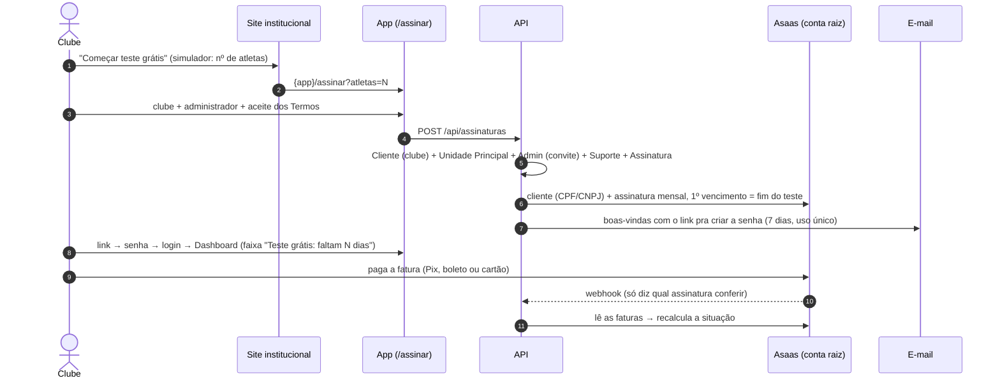

# Assinatura pelo site

> Status: **fase 1 implementada** (2026-10-09). Testada com um Asaas falso (testes HTTP) e no navegador sem gateway; **falta validar no
> sandbox do Asaas** com uma chave de verdade (criar a assinatura, pagar a fatura, ver o clube virar "Ativa").

O clube assina sozinho pelo site, recebe um e-mail, cria a senha e entra como **Admin** — sem ninguém da equipe do produto no meio.
Clientes criados à mão (antes do site, ou escola infantil) **não têm assinatura** e nada disso os afeta.

## Decisões (2026-10-08/09)

| Tema | Decisão |
|---|---|
| Teste grátis | **7 dias, configurável** (`Assinatura:DiasTeste`; **0 = sem teste**, paga antes de entrar). Sem cartão no cadastro. |
| Preço | **R$ 60 por mês com até 20 atletas + R$ 4 por atleta acima** (desde 2026-10-14; antes R$ 99 + R$ 3/atleta). `Assinatura:PrecoFixo`/`AtletasIncluidos`/`PrecoPorAtleta`; o site tem os mesmos em `site/precos.js`. Baixar o preço não exige aviso; **subir exige 30 dias** (Termos). |
| 1ª fatura | Pelos atletas **informados no cadastro**. (Recalcular pelos atletas ativos é da fase 2.) |
| Formas de pagamento | **Pix, cartão e boleto** — o clube escolhe na página de pagamento do Asaas (`billingType: UNDEFINED`); nunca recebemos dado de cartão. |
| Atraso | Suspende **7 dias depois do vencimento, configurável** (`Assinatura:DiasToleranciaAtraso`). |
| Teste nunca pago | Apagar os dados **30 dias depois da suspensão** (`Assinatura:DiasRetencaoAposSuspensao`) — **ainda não aplicado** (fase 3). |
| Mesmo CPF/CNPJ | Permitido (um dono pode ter duas escolas). Sem aviso: diria a um anônimo quem já é cliente. |
| Segmento | Sempre **Clube**. |

## Fluxo

**Sem teste (`DiasTeste = 0`)**: o cadastro cria tudo igual, mas a assinatura nasce `AguardandoPagamento` (1ª fatura vence hoje), a tela
mostra **"Pagar agora"** e o e-mail de boas-vindas **só sai quando o pagamento é confirmado**. (O desenho inicial previa uma tabela de
"pedido" fora do isolamento por cliente; criar o cliente já no cadastro deixou um caminho só pros dois modos.)

## Peças

- **Entidade** `Assinatura` (uma por cliente, isolada por `ClienteId` como as demais; migration `AddAssinaturas`, só tabela nova):
  situação, teste até, 1º vencimento, valor, atletas informados, dados de cobrança (CPF/CNPJ, cidade, celular, e-mail), ids no Asaas +
  ambiente, link da fatura em aberto, quando o convite saiu, datas (criada, suspensa, cancelada) e a **prova do aceite dos Termos**
  (versão `AssinaturaService.VersaoTermosUso`, data, IP, navegador).
- **`SituacaoAssinatura`** (inteiro, **não reordenar**): `AguardandoPagamento`, `EmTeste`, `Ativa`, `EmAtraso`, `Suspensa`, `Cancelada`.
  Regra pura em `SituacaoAssinaturaCalculo` (`Escola.Infrastructure/Assinaturas/`, com testes): fatura vencida há mais que a tolerância →
  `Suspensa`; vencida dentro da tolerância → `EmAtraso` (ou `AguardandoPagamento` se nunca pagou e não teve teste); nada vencido e
  nada pago → `EmTeste`/`AguardandoPagamento`; senão `Ativa`. Sem faturas conhecidas usa o 1º vencimento (o teste acaba mesmo sem
  gateway). **Bloqueiam**: `AguardandoPagamento`, `Suspensa`, `Cancelada`.
- **`AssinaturaService`** (`Escola.Api/Servicos/`): `CadastrarAsync` (cliente novo = escopo novo com `ClienteAtual.Definir`), 
  `AtualizarAsync(clienteId)` (abre a assinatura no Asaas se faltou, lê as faturas, recalcula, audita a mudança como "Sistema", manda o
  convite se o acesso acabou de ser liberado). **Gateway configurado e fora do ar = não mexe na situação** (não suspende quem pagou por
  falha nossa).
- **`AssinaturasWorker`**: recalcula todas as assinaturas a cada `Assinatura:IntervaloAtualizacaoMinutos` (60) — é o que faz o teste
  acabar e a suspensão acontecer. Desligado no ambiente `Testing`.
- **Endpoints** (`AssinaturasController`): `GET /api/assinaturas/plano` e `POST /api/assinaturas` (**anônimos**; cadastro com freio de
  5 por IP a cada 15 min), `POST /api/assinaturas/asaas/webhook` (anônimo, cabeçalho `asaas-access-token` = `Assinatura:WebhookToken`; o
  corpo só diz qual assinatura conferir), `GET /api/assinaturas/minha` e `POST …/minha/atualizar` (**Admin ou Suporte**; 404 pra cliente
  sem assinatura).
- **Bloqueio**: na `Autenticacao.ConferirAsync` (a cada requisição) e no login. Assinatura bloqueada → a equipe é recusada (401, não
  entra); o **Admin entra**, mas um middleware responde **402** a tudo fora de `/api/assinaturas`, `/api/auth` e `GET
  /api/configuracao/escola`. O Suporte não é afetado. `Cliente.Ativo` continua sendo o interruptor manual do Suporte.
- **Frontend**: `/assinar` (pública, 2 etapas + "confira seu e-mail" ou "Pagar agora"; link no login: "Comece seu teste grátis"),
  **Configurações → Assinatura** (`/configuracoes/assinatura`, Admin/Suporte: situação, "Pagar agora", "Já paguei — conferir agora",
  plano, faturas), **faixa no topo** pro Admin (`app-aviso-assinatura`: dias de teste, atraso, suspenso), e o Admin bloqueado é levado
  pra tela da assinatura pelos guards e pelo interceptor (402).
- **Site institucional**: botões "Começar teste grátis" apontam pro `/assinar` do app (`URL_APP` em `site/precos.js`), com o número de
  atletas do simulador. O `site/assinar.html` (protótipo) foi removido.

## Fase 2 (desde 2026-10-13)

- **Valor pelos atletas ativos**: depois da 1ª fatura paga, a cada atualização o valor vira `CalcularValor(atletas ativos)` (mínimo até `AtletasIncluidos` + `PrecoPorAtleta` por atleta acima) (`Aluno.Ativo`), gravado em `ValorMensal`/`AtletasCobrados` e enviado ao Asaas (`PUT /subscriptions/{id}` com `updatePendingPayments`, que corrige também a fatura gerada e não paga). **Não muda** no teste (vale o informado), com fatura **vencida** em aberto, nem nos **3 dias antes do vencimento** (`SituacaoAssinaturaCalculo.DiasValorCongelado`/`PodeAtualizarValor`). Cada mudança fica no histórico ("Valor do plano alterado… (N atletas ativos)").
- **Cancelar** (`POST /api/assinaturas/minha/cancelar`, Admin ou Suporte, com confirmação na tela): encerra a assinatura no Asaas (`DELETE /subscriptions/{id}` — sem faturas novas, pendentes removidas) e o acesso segue até `AcessoAte` = vencimento da fatura em aberto (período pago) ou fim do teste; com fatura **vencida**, termina hoje (`AcessoAteAoCancelar`). Depois disso a situação vira `Cancelada` (bloqueia como a suspensa). Faixa no topo: "Assinatura cancelada: o acesso termina em…". **Não há "desfazer" pela tela** (reativar exige criar outra assinatura no Asaas — fale com o suporte).
- **Forma de pagamento**: não há tela de troca — com `billingType: UNDEFINED` o clube escolhe Pix, boleto ou cartão em cada fatura, na página do Asaas.
- **Avisos por e-mail** (`EnviarAvisosAsync`): o lembrete do **fim do teste** (`DiasLembreteTeste` = 2 dias antes, com o link de pagamento) e o aviso de **acesso suspenso**, uma vez cada (`LembreteTesteEnviadoEm`/`AvisoSuspensaoEnviadoEm`; voltar a `Ativa` rearma o aviso de suspensão). Vão para o e-mail de cobrança do cadastro. Sem SMTP não envia nem marca. **Faturas (desde 2026-10-14)**: as notificações do Asaas ficam **desligadas** (`notificationDisabled` no cliente da conta raiz — custam R$ 0,99 por cobrança paga) e o sistema manda, pelo próprio SMTP, um aviso de cada tipo por fatura (`EnviarAvisoFaturaAsync`, regra pura em `AvisosFaturaCalculo`): **lembrete** 3 dias antes do vencimento (só `Ativa` — no teste vale o lembrete do fim do teste), **atraso** com a data em que suspende (só `EmAtraso`) e **recibo** do pagamento (só pago nos últimos 5 dias, pra não mandar recibo de fatura antiga), com o link da fatura do Asaas e a frase "aparece como CJF Technology". Guardados por id da fatura em `LembreteFaturaId`/`AvisoAtrasoFaturaId`/`ReciboFaturaId` (migration `AddAvisosFaturaAssinatura`); um aviso por rodada da tarefa. Clientes criados no Asaas **antes** disso (só os de sandbox) continuam com as notificações do Asaas ligadas.
- **Plataforma**: cartão "Assinatura" pro Suporte (situação, valor, atletas, teste/vencimento/cancelamento) com link pra tela da assinatura.
- Migration `AddAssinaturaFase2` (só colunas nullable). Testes: `SituacaoAssinaturaCalculoTests` (cancelamento, acesso ao cancelar, congelamento do valor) e `AssinaturaHttpTests` (valor pelos ativos com a fatura pendente corrigida, Coordenador não cancela, cancelamento mantém o acesso e depois bloqueia com 402, lembrete e aviso de suspensão saem uma vez só).

## Reativar, retenção e registros de acesso (desde 2026-10-13)

- **Reativar** (`POST /api/assinaturas/minha/reativar`, Admin/Suporte): abre uma assinatura **nova** no Asaas (a cancelada não volta).
  Dentro do acesso, a próxima fatura vence no fim do período pago; depois dele, vence hoje — ou no fim do teste, se o clube nunca pagou
  e o teste ainda não acabou. `Assinatura.JaPagou` registra que já houve pagamento (a assinatura nova não traz as faturas antigas).
- **Exclusão dos dados**: `DataExclusao` = 30 dias (`DiasRetencaoAposSuspensao`) depois do fim do acesso de uma **cancelada** ou da
  suspensão de um teste **que nunca pagou**. Suspensa que já pagou **nunca** é apagada. E-mail 7 dias antes (`AvisoExclusaoEnviadoEm`), e
  a exclusão só acontece 7 dias depois desse aviso; pagar ou reativar interrompe. `ExclusaoDadosCliente` apaga todas as tabelas isoladas
  por cliente (descobertas pelo modelo do EF, na ordem das chaves estrangeiras, numa transação), as fotos e os documentos, e anonimiza o
  `Cliente`. **Desligada por padrão** (`Assinatura:ExclusaoAutomatica`): desligada, só avisa e escreve no log.
- **Registros de acesso** (Marco Civil, art. 15): login, senha pelo link e primeiro uso do dia, com IP e navegador; sem tela; apagados
  depois de 6 meses. Ficam mesmo depois da exclusão do clube.

## Fases

| Fase | Entrega |
|---|---|
| **1 — MVP** ✅ | Tudo acima. |
| **2 — Ciclo** ✅ (2026-10-13) | Valor pelos atletas **ativos** depois da 1ª fatura paga; cancelar pela tela; e-mail no fim do teste e na suspensão; cartão da assinatura na Plataforma. Ver "Fase 2" abaixo. |
| **3 — Retenção** ✅ (2026-10-13) | Reativar pela tela; exclusão dos dados de cancelados e testes nunca pagos (desligada por padrão); registros de acesso do Marco Civil. Ver "Reativar, retenção e registros de acesso" acima. |
| **4 — Crescimento** (em parte, 2026-10-13) | ✅ Cupons de desconto; ✅ painel do Suporte com todos os clientes. Falta: NFS-e pelo Asaas. Ver "Cupons" abaixo. |

## Cupons de desconto (desde 2026-10-13)

- **Criados pelo Suporte** em Plataforma → Clientes (`PlataformaCuponsController`, `api/plataforma/cupons`, só `Suporte`): código
  (único, guardado em maiúsculas), desconto de 0–99% (100% é recusado: fatura de R$ 0 o Asaas não aceita), por quantas mensalidades
  (vazio = todas), **meses grátis** (1–12, desde 2026-10-15: o teste passa a durar esses meses e a 1ª fatura, cheia, vence no fim deles —
  `CupomRegras.FimDoTeste`; copiado pra `Assinatura.CupomMesesGratis` só pra exibir), validade e limite de usos opcionais,
  observação. Sem exclusão: desativar/ativar. Mudanças vão pro **log da aplicação**, não pro histórico de um cliente (o cupom não é
  de nenhum cliente).
- **`Cupom` é a única entidade da plataforma** (`IEntidadePlataforma`): fica fora do isolamento por cliente (sem `ClienteId`, sem filtro
  global) e fora da exclusão de dados. A lista é fechada — `IsolamentoPorClienteTests.SoOsCuponsSaoDaPlataforma` falha se outra
  entidade ganhar o marcador.
- **No `/assinar`**: campo "Cupom" no resumo; `GET /api/assinaturas/cupom/{codigo}` (anônimo, freio de 10 falhas por IP) confere e
  mostra o desconto. O `POST /api/assinaturas` valida de novo (ativo, dentro da validade, abaixo do limite de usos — contado nas
  assinaturas de todos os clientes).
- **Na assinatura**: código, percentual e meses são **copiados** pra `Assinatura` (`CupomCodigo`/`CupomPercentual`/`CupomMeses`) —
  mudar ou desativar o cupom depois não afeta quem já assinou. A 1ª fatura sai com desconto; depois, o valor pelos atletas ativos
  (`AtualizarValorAsync`) continua com desconto enquanto as mensalidades pagas forem menos que `CupomMeses` (`CupomRegras`, puro e
  testado). Aparece na tela Assinatura do clube.
- **Limitação**: reativar abre uma assinatura nova no Asaas e a contagem de mensalidades pagas recomeça (o desconto pode valer de novo).

## Pendências antes de produção

1. **SMTP** — sem ele o e-mail de boas-vindas não chega.
2. **Termos de Uso e Política de Privacidade** — publicados como texto-base em `site/termos.html`/`site/privacidade.html` (versão
   `2026-10-13`, linkados no `/assinar`): falta preencher os dados da empresa (em amarelo) e a revisão jurídica.
3. **Validar no sandbox do Asaas** e cadastrar o webhook da conta raiz no painel (ver `docs/DEPLOY.md`).
4. `URL_APP` em `site/precos.js` com o domínio de produção.
