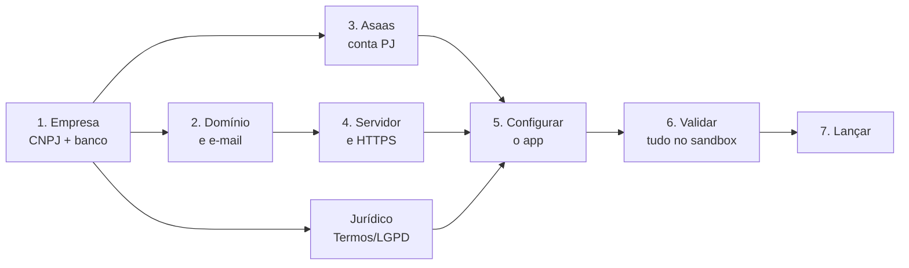

# Colocando o Gestor Tático no ar — passo a passo

Roteiro do **zero até o primeiro cliente pagante**, na ordem em que as coisas dependem umas das outras. O detalhe técnico de cada
variável está em [`DEPLOY.md`](DEPLOY.md); a assinatura pelo site, em [`ASSINATURA.md`](ASSINATURA.md).

> Custos são **ordens de grandeza** pra planejar, não orçamento — confira o preço atual em cada serviço. Onde há decisão fiscal ou
> jurídica, quem bate o martelo é o **contador** ou o **advogado**.

**Legenda**: 👤 você faz · 🤖 eu (Claude) faço quando você me passar o que está indicado · ⏱️ prazo típico

---

## Fase 1 — Empresa e jurídico (comece já: é o que mais demora)

### 1.1 👤 Contratar um contador ⏱️ 1 semana
- Peça indicação de quem atende **empresa de software/SaaS**. Ele abre a empresa, escolhe o regime e cuida das notas.
- Custo: mensalidade de contabilidade (algumas centenas de reais/mês; há contabilidades online mais baratas).

### 1.2 👤 Abrir o CNPJ ⏱️ 1–4 semanas
- **Por que precisa**: o Asaas da plataforma (que cobra os clubes e abre subcontas pras escolas) deve ser **conta PJ**; os Termos
  precisam de razão social e CNPJ; a nota fiscal sai do CNPJ.
- Converse com o contador sobre:
  - **Tipo**: provavelmente **SLU/ME no Simples Nacional**. O **MEI em geral não cobre licenciamento de software** — confirme.
  - **CNAE**: algo como **6203-1/00** (licenciamento de programas não customizáveis) e/ou **6311-9/00** (hospedagem/SaaS).
  - **Inscrição municipal** — necessária pra emitir **NFS-e** (nota de serviço) das assinaturas.
- Guarde: razão social, CNPJ, endereço, inscrição municipal.

### 1.3 👤 Conta bancária PJ ⏱️ 1–3 dias
- Qualquer banco digital PJ serve. É pra onde o Asaas transfere o que os clubes pagam.

### 1.4 👤 Registrar a marca no INPI (recomendado, não bloqueia o lançamento) ⏱️ pedido em 1 dia; concessão em ~1–2 anos
- Pesquise antes em **busca.inpi.gov.br** se "Gestor Tático" está livre na classe de software (classe **42**, e talvez **9**).
- O pedido já dá **prioridade** sobre quem pedir depois. Custo: algumas centenas de reais por classe (ME tem desconto).
- O logo já está pronto em `docs/marca/` — pra INPI/gráfica, **converter o texto do logo em curvas**.

### 1.5 👤 Advogado: Termos, Privacidade e termo de matrícula ⏱️ 1–3 semanas
- Leve os três textos-base que já existem:
  - `site/termos.html` — Termos de Uso (contrato com o clube).
  - `site/privacidade.html` — Política de Privacidade.
  - `backend/Escola.Api/Servicos/TermoMatricula.cs` — termo que **os pais aceitam** no portal (dados de menores, saúde).
- Defina o **encarregado de dados (DPO)** da LGPD — pode ser você — e um e-mail de contato pra ele (ex.: `privacidade@seudominio`).
- Peça atenção a: dado de saúde de menores, retenção e exclusão (30 dias após cancelamento), registros de acesso (6 meses, Marco
  Civil), reajuste com aviso de 30 dias, foro.
- 🤖 Depois da revisão: eu aplico os textos, preencho os campos amarelos (razão social, CNPJ, endereço, DPO, foro, provedores de
  hospedagem e e-mail) e troco a versão dos documentos. **Me passe**: os textos revisados e os dados da empresa.

---

## Fase 2 — Domínio e e-mail

### 2.1 👤 Comprar o domínio ⏱️ minutos (com CNPJ ou CPF)
- **registro.br** pra `.com.br` (custo anual baixo, na faixa de dezenas de reais). Sugestão: registrar também o `.com` se estiver
  livre, pra ninguém pegar.
- Vamos usar dois endereços (exemplo com `gestortatico.com.br`):

| Endereço | O que é |
|---|---|
| `gestortatico.com.br` e `www.` | Site institucional (venda, preços, Termos) |
| `app.gestortatico.com.br` | O sistema (login, `/assinar`, API em `/api`) |

### 2.2 👤 DNS (recomendado: Cloudflare, plano gratuito) ⏱️ 1 hora
- Aponte o domínio do registro.br pros servidores de DNS da Cloudflare (mais fácil de gerenciar, e dá proteção extra).
- Os registros (A/CNAME) do site e do app você cria na Fase 4, quando tiver o servidor.

### 2.3 👤 E-mail profissional (pra pessoas) ⏱️ 1 hora
- Google Workspace, Zoho Mail ou Microsoft 365 — algumas dezenas de reais por caixa/mês (o Zoho tem plano gratuito pequeno).
- Caixas sugeridas: `contato@`, `suporte@` (vai no login do Suporte), `financeiro@` (Asaas), `privacidade@` (DPO).

### 2.4 👤 E-mail transacional (o que o sistema envia) ⏱️ 1–2 horas
- **Não use o Gmail pessoal**: convites, códigos de verificação e avisos precisam chegar e não cair no spam.
- Serviço SMTP: **SMTP relay do Google Workspace** (em uso; sem rastreio), **Brevo** (grátis 300/dia, mas rastreio e "cancelar inscrição" obrigatórios), **Resend**, **Amazon SES** ou **Mailgun**.
- No painel do serviço, **verifique o domínio**: ele dá registros **SPF, DKIM e DMARC** pra criar no DNS. Sem isso, cai no spam.
- Remetente sugerido: `nao-responda@gestortatico.com.br`, nome "Gestor Tático".
- **Me passe**: host, porta, usuário, senha SMTP e o e-mail remetente. 🤖 Eu configuro e testo convite, esqueci a senha e código.

---

## Fase 3 — Asaas (recebimentos)

O Asaas tem dois papéis: (a) **conta raiz da plataforma**, que cobra a assinatura dos clubes (R$ 60 até 20 atletas + R$ 4 por atleta acima); (b) **subcontas**,
uma por escola, pra escola cobrar a mensalidade dos atletas por Pix com baixa automática.

### 3.1 👤 Conta sandbox (testes) ⏱️ 1 hora — **pode fazer hoje, sem CNPJ**
- Crie em **sandbox.asaas.com** e gere uma **chave de API** (`$aact_hmlg_...`).
- **Me passe** a chave. 🤖 Eu valido o fluxo inteiro: cadastro no `/assinar` → assinatura na conta raiz → pagar pelo painel do
  sandbox → clube vira "Ativa"; cupom; subconta da escola → Pix → baixa automática. Hoje isso só foi testado com um Asaas falso.

### 3.2 👤 Conta de produção (PJ) ⏱️ 2–7 dias (análise de documentos)
- Crie em **asaas.com** com o **CNPJ** e envie os documentos (contrato social, documento do sócio, comprovante de endereço).
- Vincule a **conta bancária PJ** pra saques.
- Crie a **chave Pix** da conta.
- Pergunte ao comercial do Asaas sobre a **criação de subcontas via API** (o modelo "marketplace/white label") e as taxas — o sistema
  cria uma subconta por escola automaticamente.

### 3.3 👤 Configurações da conta de produção ⏱️ 30 min
- Gere a **chave de API de produção** (`$aact_prod_...`) — guarde num cofre de senhas.
- Cadastre o **webhook da assinatura** no painel: URL `https://app.gestortatico.com.br/api/assinaturas/asaas/webhook`, com um token
  longo e aleatório (🤖 eu gero pra você). Os webhooks das subcontas o sistema cadastra sozinho.

### 3.4 👤 Nota fiscal (NFS-e) das assinaturas ⏱️ depende da prefeitura
- Com a inscrição municipal, dá pra configurar a emissão de **NFS-e pelo próprio Asaas** (ele emite a cada pagamento). Combine com o
  contador o código de serviço e as alíquotas.
- O sistema **ainda não** liga a emissão sozinho — por ora configure direto no painel do Asaas. (Automatizar é uma tarefa futura.)

---

## Fase 4 — Servidor e publicação

### 4.1 👤 Contratar o servidor ⏱️ 1 hora
- Um **VPS Linux** com **2 vCPU / 4 GB de RAM** aguenta bem o começo. Prefira **data center no Brasil** (latência e LGPD):
  Magalu Cloud, Locaweb, AWS (São Paulo), Google Cloud (São Paulo), Hostinger… Ordem de grandeza: dezenas a ~R$ 150/mês.
- **Banco**: no início, o Postgres pode rodar no mesmo servidor (Docker) **com backup diário fora dele**. Quando crescer, um Postgres
  gerenciado (backup automático) vale o custo.
- **Me passe**: acesso SSH ao servidor (ou faça junto comigo). 🤖 Eu instalo Docker, subo banco, API e app.

### 4.2 🤖 Instalar e subir ⏱️ 1–2 horas
- Docker + Docker Compose, o `docker-compose.yml` do projeto e o `.env` (Fase 5).
- **HTTPS**: um **Caddy** na frente, que emite e renova o certificado sozinho (Let's Encrypt), pra `app.` e pro site.
- DNS (👤 na Cloudflare): registros `A` de `app.`, `@` e `www` apontando pro IP do servidor.
- Site institucional (`site/`): é estático — sobe no mesmo Caddy, ou em Cloudflare Pages/Netlify (grátis).

### 4.3 🤖 Backup e monitoramento ⏱️ 1 hora
- `pg_dump` diário + os volumes `fotos` e `documentos` (**exames e laudos de menores — criptografar**) copiados **pra fora do
  servidor** (ex.: um bucket S3/Backblaze/Google Drive da empresa). Guarde 30 dias.
- **Testar um restore de verdade** uma vez antes do lançamento.
- Monitoramento: **UptimeRobot** (grátis) chamando `https://app.gestortatico.com.br/healthz` a cada 5 min, avisando no seu e-mail/WhatsApp.

---

## Fase 5 — Configurar o sistema

### 5.1 🤖 Gerar os segredos (eu gero; você guarda num cofre de senhas — Bitwarden/1Password)

| Variável | O que é | Cuidado |
|---|---|---|
| `JWT_CHAVE` | assina os logins | trocar = todo mundo sai |
| `SEGREDOS_CHAVE` | criptografa chaves do Asaas e 2FA no banco | **nunca trocar depois** de conectar escolas |
| `SUPORTE_SENHA_HASH` + `SUPORTE_TOTP_SEGREDO` | sua conta de Suporte | a senha você digita; o segredo vai no seu app autenticador |
| `ASAAS_WEBHOOK_TOKEN` / `ASSINATURA_WEBHOOK_TOKEN` | conferem que o aviso veio do Asaas | o segundo é o que vai no painel do Asaas (3.3) |
| Senha do banco | usuário próprio da aplicação | nunca o `postgres` |

### 5.2 🤖 Preencher o `.env` de produção
- Banco, `APP_URL_BASE=https://app.gestortatico.com.br`, `PROXIES_NA_FRENTE`, SMTP (2.4), Asaas (`ASAAS_AMBIENTE=Sandbox` primeiro),
  preço e dias de teste (iguais ao `site/precos.js`), `ASSINATURA_EXCLUSAO_AUTOMATICA=false` (ligar só depois, ver Fase 7).

### 5.3 🤖 Ajustes no código antes do ar
- `site/precos.js` → `URL_APP` com o endereço do app (hoje `localhost`).
- `frontend/src/environments/environment.prod.ts` → `urlSite` com o domínio do site (hoje `site-a-definir.invalid`).
- Termos/Privacidade/termo de matrícula com os textos revisados (1.5) e versão nova.
- Promessas do site conferidas por você: **sem fidelidade, usuários ilimitados, suporte por WhatsApp** (qual número?).
- **Me passe**: o domínio, o número do WhatsApp de suporte e a confirmação das promessas.

---

## Fase 6 — Validar antes de abrir (eu faço, você acompanha)

- [ ] **Asaas sandbox**: cadastro no `/assinar` → fatura → pagamento no painel → "Ativa"; cupom; atraso → suspensão; reativar.
- [ ] **Subconta**: conectar uma escola de teste → Pix de mensalidade → pagar no sandbox → baixa automática; Pix em cobrança cancelada → alerta.
- [ ] **E-mail real**: convite da equipe, convite do responsável (matrícula), esqueci a senha, código de verificação por e-mail — e conferir que **não caem no spam**.
- [ ] **Celular**: login, portal da família, chamada, mensalidades.
- [ ] **Backup**: restaurar o dump num banco vazio e abrir o sistema.
- [ ] **Segurança**: checklist do `DEPLOY.md` (HTTPS, banco fechado pra internet, segredos no cofre, Suporte com 2FA).
- [ ] **CI verde** no GitHub (aba Actions) no commit que vai pro ar.

---

## Fase 7 — Lançamento

1. 🤖 Trocar o Asaas pra **produção** (`ASAAS_AMBIENTE=Producao` + chave `$aact_prod_`) e reiniciar.
2. 👤 Fazer **uma assinatura real sua** (com cupom de 100% ou pagando e estornando) pra ver o dinheiro chegar.
3. 👤 Convidar o **primeiro clube piloto** (cupom de lançamento, ex.: 50% nos 3 primeiros meses — eu crio pelo painel do Suporte).
4. 👤🤖 Nas primeiras semanas: olhar os logs, o UptimeRobot e o painel **Plataforma → Clientes** todo dia.
5. 🤖 Depois de ~1 mês sem surpresas nos logs de retenção: ligar `ASSINATURA_EXCLUSAO_AUTOMATICA=true` (exclusão de dados de
   cancelados e testes abandonados, que os Termos prometem).

---

## Rotina depois do lançamento

- **Atualizações**: `git pull && docker compose up -d --build` — sempre com **backup antes** (as migrations não têm "desfazer").
- **Backups**: conferir que estão chegando; restaurar um por trimestre.
- **Mudou preço?** `site/precos.js` **e** `ASSINATURA_PRECO_*`, e avisar os clientes com 30 dias (Termos).
- **Mudou um texto jurídico?** trocar a versão (`site/paginas.js` + `AssinaturaService.VersaoTermosUso`; no termo de matrícula, `TermoMatricula.Versao`).
- **Contador**: NFS-e, impostos do Simples, pró-labore.

---

## Resumo: o que destrava o quê

| Você me passa | Eu consigo |
|---|---|
| Chave **sandbox** do Asaas | validar assinatura, cupom e Pix das escolas de ponta a ponta (dá pra fazer **já**) |
| Dados **SMTP** | ligar todos os e-mails e testar entrega/spam |
| **Domínio** + acesso ao **servidor** | publicar app e site com HTTPS, backup e monitoramento |
| **Textos revisados** + **dados da empresa** | finalizar Termos, Privacidade e termo de matrícula |
| Chave de **produção** do Asaas | virar a chave pra produção no lançamento |

**Caminho mais curto**: abrir o CNPJ e falar com o advogado **em paralelo** (são os mais lentos) enquanto fazemos sandbox do Asaas,
domínio, e-mail e servidor. Com isso, o gargalo passa a ser só a análise da conta PJ no Asaas.
